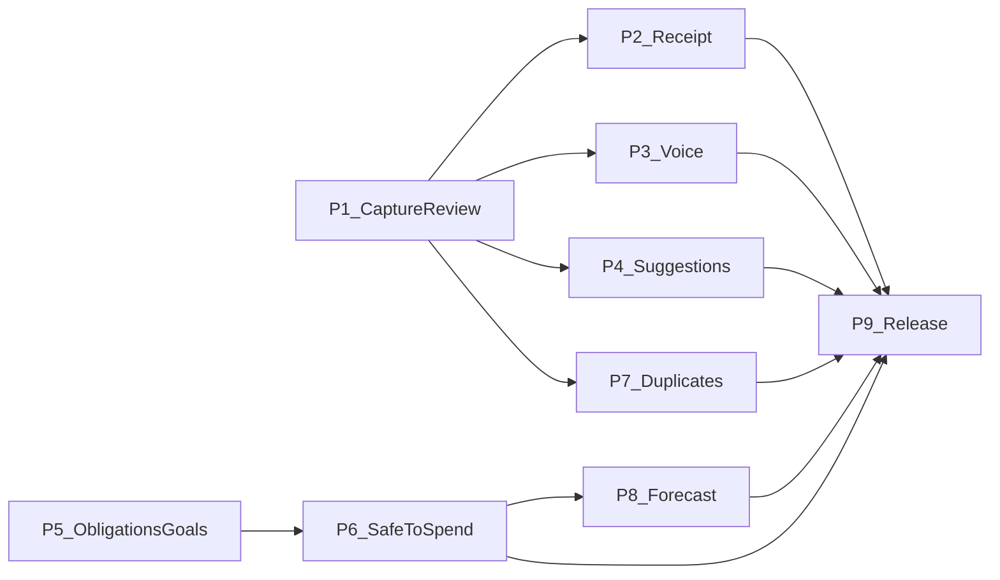

# Remaining BRD phases

These documents split the work in [brd.md](../brd.md) that the current app does not implement yet. They follow [implementation-plan.md](../implementation-plan.md).

Each file is a phase brief. None of them change application code.

Already built, and not a phase here: accounts, categories, transactions, dashboard, reports, and backup. Those appear only as dependencies.

Excluded: FR-018 (decision simulation) and FR-019 (AI financial coach). Both are Could items and sit outside the MVP.

## Phases

| Phase | Document | Requirements | Estimate | Can start |
|---|---|---|---|---|
| 1 | [Capture draft and review](phase-01-capture-review.md) | FR-009, BR-005, AC-004 | 1 week | Now |
| 2 | [Receipt capture](phase-02-receipt-capture.md) | FR-007, NFR-003, NFR-006 | 1.5 weeks | After phase 1. OCR provider blocks the extractor, not the photo step. |
| 3 | [Voice capture](phase-03-voice-capture.md) | FR-008, NFR-003, NFR-006 | 1 week | After phase 1 |
| 4 | [Category suggestions](phase-04-category-suggestions.md) | FR-010, NFR-007, NFR-008, AC-009 | 1.5 weeks | After phase 1. Cloud provider blocks only the cloud data source. |
| 5 | [Obligations and savings goals](phase-05-obligations-and-goals.md) | FR-012 | 2 weeks | Now, in parallel with phase 1 |
| 6 | [Safe-to-Spend](phase-06-safe-to-spend.md) | FR-013, BR-004, BR-009, AC-006 | 1 week | After phase 5, and after the formula is confirmed |
| 7 | [Duplicate warning](phase-07-duplicate-warning.md) | FR-016, AC-008 | 0.5 week | After phase 1, so captured saves are covered too |
| 8 | [Cash-flow forecast](phase-08-cash-flow-forecast.md) | FR-017 | 1.5 weeks | After phases 5 and 6 |
| 9 | [Release readiness](phase-09-release-readiness.md) | AC-010, NFR-005 | 2–4 weeks | After phases 2, 3, 4, 6, 7, and 8 |

Estimates come from the BRD roadmap: smart capture was weeks 7–10 (about 4 weeks, split across phases 1–4), Safe-to-Spend with obligations and goals was weeks 11–13 (about 3 weeks, split across phases 5 and 6), and release preparation was weeks 17–20 (phases 7–9 sit in the leftover and release time). They assume one full-time developer.

## Dependencies

Phases 1 and 5 can start together. Phase 7 needs the existing save path plus phase 1, so a transaction created from a receipt or from voice gets the same warning as a manual one.

## Decisions that block a phase

From section 8 of the implementation plan. A working default is listed so a phase can start when the default is enough.

| Decision | Working default | Blocks |
|---|---|---|
| Receipt languages | Arabic and English printed receipts. Uncertain fields are highlighted. | The OCR provider inside phase 2, not the review screen. |
| Keep images and recordings | Delete when the user leaves review, unless they opt in. | Storage in phases 2 and 3. The default lets those phases start. |
| OCR and AI providers | No provider in the first slice. Local text match only. | Cloud half of phase 4, and the real OCR engine in phase 2. |
| Obligation types and reminders | Monthly fixed amount and a due day. No push reminder. | Nothing, if this default holds. Phase 5 uses it. |
| Safe-to-Spend lines | Proposal in phase 6. Do not code the calculator until confirmed. | Phase 6. |
| Salary date for the forecast | Not defined in the BRD. Phase 8 proposes one payday setting. | Phase 8, until that setting is accepted. |
| Minimum OS versions | Whatever the Flutter project already targets. Record the numbers at release. | Phase 9 recording, not feature design. |
| Multiple currencies | Stay on one currency, integer minor units. | Nothing. |
| Extra backup encryption | Keep Firebase Auth and Firestore rules. No second passphrase. | Nothing further. |

## Suggested order

1. Phase 1 and phase 5 in parallel.
2. Phases 2, 3, and 4 on top of phase 1. Phase 4 ships the local matcher first and leaves the cloud classifier as a no-op.
3. Confirm the Safe-to-Spend lines, then phase 6.
4. Phase 7 after phase 1. Phase 8 after phases 5 and 6.
5. Phase 9 last, once the Must and Should slices above are in place.
